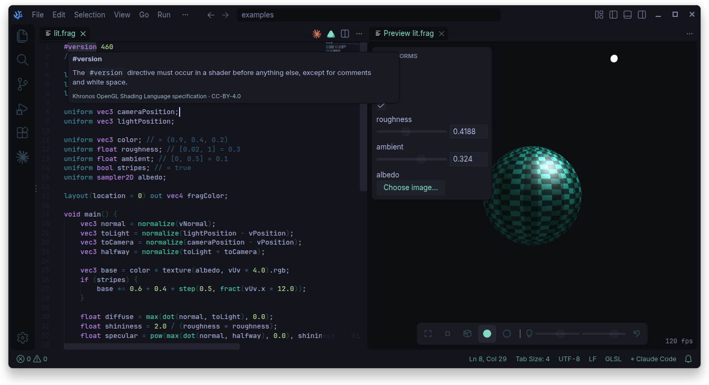
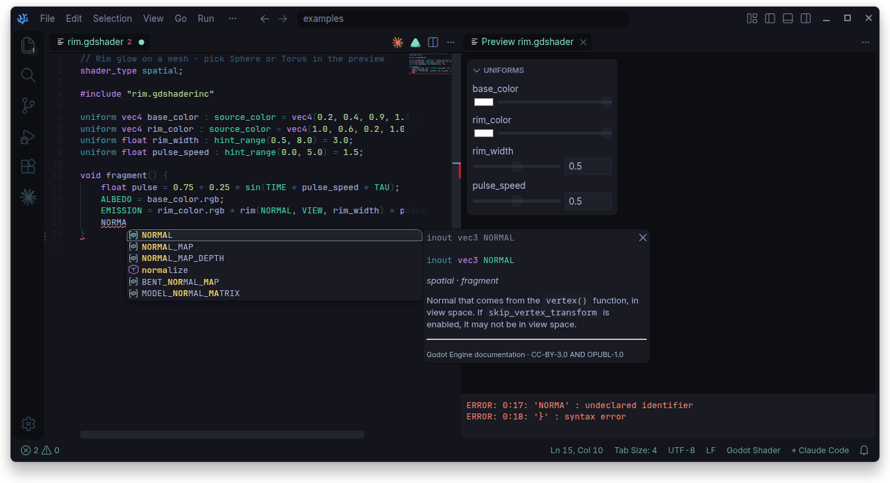
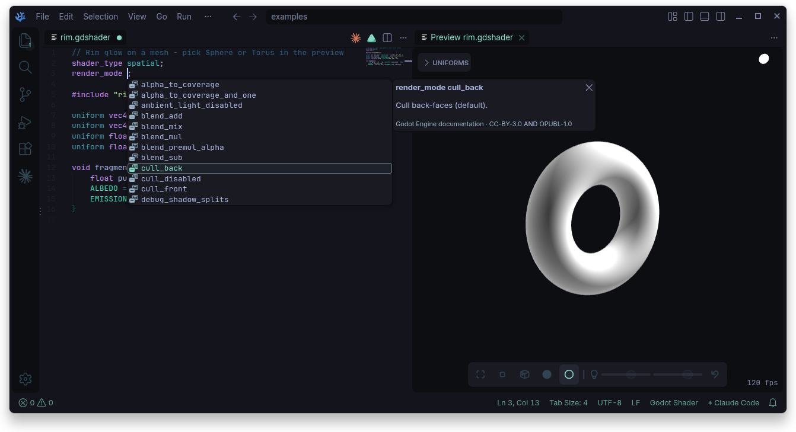

#  GLSL & GDShader for VS Code

Comprehensive language support for GLSL, GLSL ES and GDShader.

All that's necessary is bundled, with nothing unnecessary.

- Hover docs and completion
- Go to definition and outline
- Compile errors from [glslang](https://github.com/KhronosGroup/glslang)
- `#include` support
- Custom built-ins - add declarations in Settings
- Live preview (optional)







## Live Preview

Press `Ctrl+Shift+V` or the &nbsp;  &nbsp; button in the editor title bar to open the preview for a given shader file.

Preview sliders for a uniform are controlled via `[range] = default value` comment:

```glsl
uniform float roughness; // [0, 1] = 0.5
```

Uniforms automatically filled-in:

| Uniform | |
| --- | --- |
| `float time` / `u_time` | Seconds |
| `vec2 resolution` / `u_resolution` | Canvas size (px) |
| `vec2 mouse` / `u_mouse` | Mouse position (px) |
| `int frame` / `u_frame` | Frame count |
| `vec3 lightPosition` `cameraPosition` | World space |


## License

- [MIT](LICENSE)
- Built-in docs from:
   - [Khronos GLSL spec](https://github.com/KhronosGroup/GLSL) ([CC BY 4.0](https://creativecommons.org/licenses/by/4.0/))
   - [Godot docs](https://github.com/godotengine/godot-docs) ([CC BY 3.0](https://creativecommons.org/licenses/by/3.0/))
- Licenses bundled in extension:
   - [glslang](https://github.com/KhronosGroup/glslang) (BSD)
   - [SPIRV-Cross](https://github.com/KhronosGroup/SPIRV-Cross) (Apache-2.0)
   - [three.js](https://github.com/mrdoob/three.js) (MIT)
   - [Codicons](https://github.com/microsoft/vscode-codicons) (CC BY 4.0)
